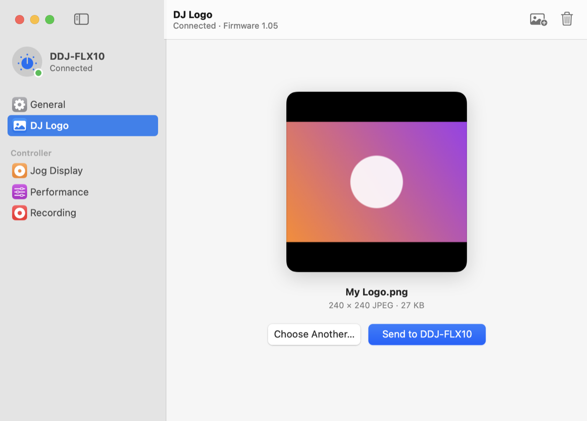
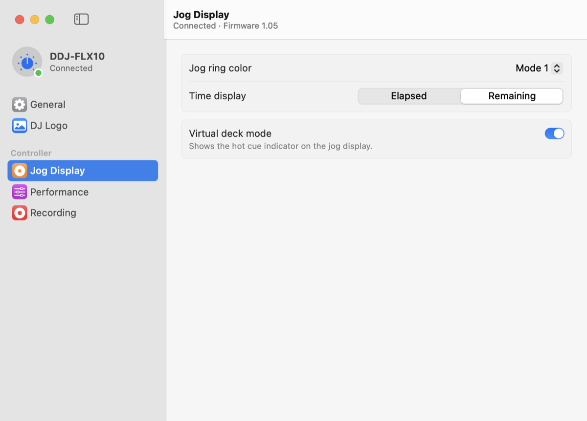
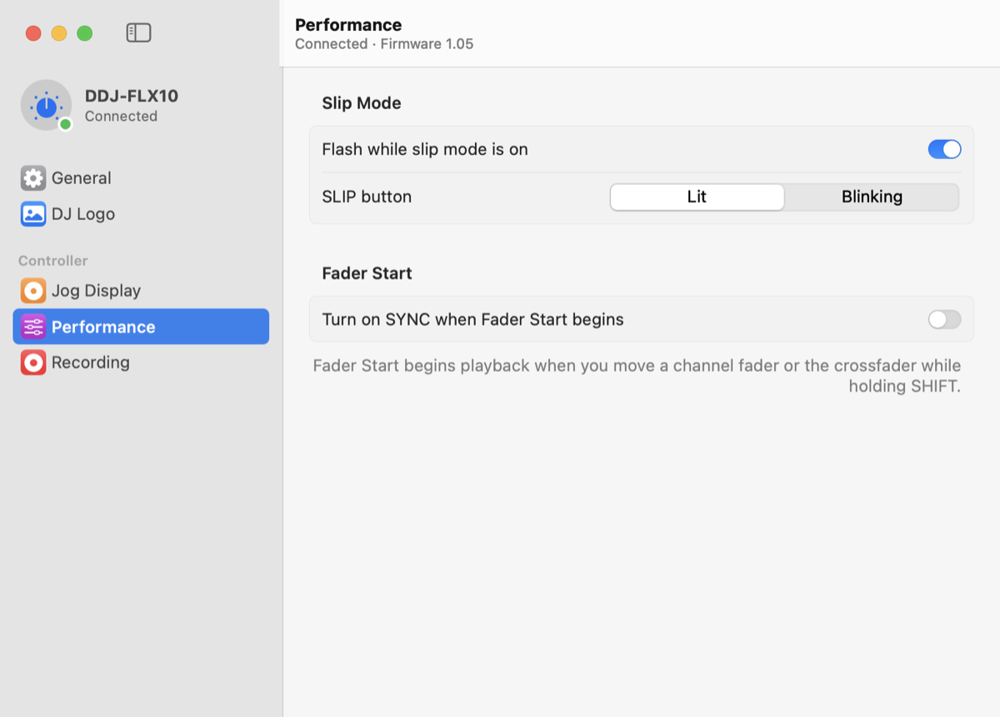
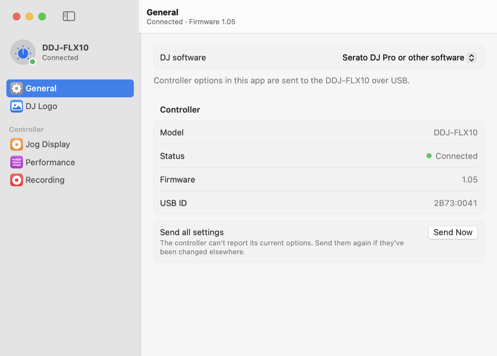

# FLX10 Utility

[](https://github.com/ginomessmer/ddj-flx-10-util/actions/workflows/ci.yml)
[](LICENSE)


An unofficial, open-source macOS app for the Pioneer DJ / AlphaTheta **DDJ-FLX10** controller. It
replaces both of the vendor's macOS tools in one native SwiftUI app:

* **DDJ-FLX10 Setup** — jog ring color, time display, virtual deck mode, slip mode, Fader Start
  sync and REC OUT options
* **DDJ-FLX10 Image Transfer Tool** — upload or remove the custom DJ logo shown on the jog displays,
  with a small editor to fit the whole image or fill the display and pick the crop

It needs neither the vendor's `DDJ-FLX10Setup.framework` nor its `AutoLauncherd` background agent.

> [!WARNING]
> **Unofficial software, use at your own risk.** This project is not made, endorsed or supported by
> Pioneer DJ or AlphaTheta Corporation. It talks to your controller using a protocol recovered by
> reverse engineering, which has **not been verified against every firmware version**. It is
> provided **as is, without warranty of any kind**, and the authors accept **no liability** for any
> damage to your hardware, data or performances. Using it may affect your manufacturer warranty or
> support. See [Disclaimer](#disclaimer).



| Jog Display | Performance | General |
| --- | --- | --- |
|  |  |  |

## Install

Download `FLX10-Utility` from the latest [CI run](https://github.com/ginomessmer/ddj-flx-10-util/actions/workflows/ci.yml)
(or build it yourself, below) and move **FLX10 Utility.app** to `/Applications`.

The app is ad-hoc signed, not notarized. On first launch macOS will refuse to open it; right-click
the app and choose **Open**, or allow it in **System Settings › Privacy & Security**.

No driver or kernel extension is installed. The app is not sandboxed because it needs direct USB
and HID access to the controller.

## Build

Requires Xcode 16 or later.

```bash
./scripts/build-app.sh
```

```bash
open "build/FLX10 Utility.app"
```

For development, use `swift run FLX10Utility` and `swift test`, or generate an Xcode project with
[XcodeGen](https://github.com/yonaskolb/XcodeGen) (the `.xcodeproj` is generated, not committed):

```bash
xcodegen generate && open FLX10Utility.xcodeproj
```

Debug builds can render every pane to PNGs without screen-recording permission, which is
useful for checking layout changes:

```bash
FLX10_SNAPSHOT_DIR=/tmp/flx10-shots swift run FLX10Utility
```

Add `FLX10_SNAPSHOT_DEMO=1` to render from the demo model (connected, sample logo), which is how
`docs/screenshots` is produced.

## Layout

| Path | Purpose |
| --- | --- |
| `Sources/CFLX10USB` | C shim for vendor control requests through `IOUSBDeviceInterface` |
| `Sources/FLX10Kit` | Protocol, transfer state machine, image encoder, settings model, IOKit transports |
| `Sources/FLX10Utility` | SwiftUI app: sidebar window (General, DJ Logo, Jog Display, Performance, Recording), Controller menu, Settings window |
| `scripts/make-icon.swift` | Renders `Resources/AppIcon.icns` |
| `Tests/FLX10KitTests` | Packet framing, state machine, encoder and settings tests |

## Recovered protocol

The protocol was recovered by static analysis of the shipped binaries: ImageTransferTool 1.0.0
(x86_64, JUCE, symbols present), Setup 1.0.0 and DDJ-FLX10Setup.framework (arm64 slices).
None of it has been checked against a live controller yet.

### Device

USB `2B73:0041`. The logo uses the HID interface with top-level usage `0`. Settings go over the
default control pipe of the USB device (bDeviceClass ≠ 9).

### DJ logo (HID)

Every output report is 128 bytes, sent with `IOHIDDeviceSetReport(Output, reportID 0)`.
Responses are 64-byte input reports, and byte 1 holds the response code.

| Step | Host → device | Device → host |
| --- | --- | --- |
| Start transfer | `00 D0 01 len[3]le` | `D8` ×2 (ready) |
| Data | `00 D1 idx[2]le count[2]le` + payload | `DC` received, then `DC` stored (`DD` = failure) |
| Start delete | `00 D0 00` | `D8` ×2 |
| Execute delete | `00 D7` | `DE` ×2 (`DF` = failure) |

* The first data report also carries `len[3]le` after the count and holds 119 payload bytes.
  Every later report holds 122. Indices start at 1.
* The payload is a 240×240 JPEG (quality 1.0). The source image is aspect-fit onto a black
  canvas and must be at most 0x2A400 bytes.
* One 10 s timeout covers the whole operation. A response that arrives while data is still
  streaming fails the transfer.

### Settings (USB control)

`bmRequestType 0x40, bRequest 0x03, wValue = value << 8, wIndex = selector, wLength 0`

| Setting | wIndex | Values (default **bold**) |
| --- | --- | --- |
| Fader Start (sync) | `C013` | 1 = SYNC on, **2 = off** |
| REC OUT | `C01D` | **0 = with mic**, 1 = without mic |
| Time Mode | `C026` | 0 = elapsed, **1 = remaining** |
| Virtual Deck Mode | `C027` | 0 = off, **1 = on** |
| Slip Mode Flashing | `C028` | 0 = disable, **1 = enable** |
| Slip button LED | `C029` | **0 = lit**, 1 = blink |
| Jog Ring Color | `C02B` | **0–2 = MODE 1–3** |

Firmware version: `bmRequestType 0xC0, bRequest 0x00, wIndex 0xC001, wLength 2`, displayed as
`"%x.%.2x"` with `byte[0]`, `byte[1]`.

The controller cannot report these settings back. The original app keeps them in
`~/Library/Preferences/com.pioneerdj.DDJ-FLX10autosetup.plist` and re-sends them when the
controller connects. This app imports that file once, then stores settings in its own defaults.
By default (configurable) it re-sends them when the controller connects.

## Differences from the originals

* **Inferred:** the REC OUT and Virtual Deck labels come from string order and defaults, not from
  traced UI bindings.
* **Not carried over:** Fader Start value `0`, which the original sends only while its checkbox is
  disabled. The meaning of that disabled state is unknown.
* **Added:** a Fill layout that covers the 240×240 display and crops the rest, with zoom and a
  draggable crop. Fit, the default, matches the original's letterboxing.
* **Changed:** if the quality-1.0 JPEG is over the size limit, this app lowers the quality step by
  step. The original fails instead.
* **Simplified:** the original scales large images down in steps of 0.7 before the final fit.
  This app uses a single high-quality CoreGraphics draw, which looks equivalent.
* **Changed:** the HID manager opens without seizing the device. The original passes option 1
  (seize).
* **Not carried over:** the original's rotation transform (a sin/cos step near the encoder) was
  not fully traced. EXIF orientation is applied instead.

## Contributing

Issues and pull requests are welcome. Reports from people who have tested with real hardware —
including firmware version and what worked or didn't — are especially useful, since the protocol
was recovered statically. Please run `swift test` before opening a pull request.

## Disclaimer

This is an independent, unofficial project. It is **not affiliated with, authorized, endorsed or
supported by Pioneer DJ, AlphaTheta Corporation** or any of their subsidiaries. Do not contact them
for support with this software.

The software is provided **"as is", without warranty of any kind**, express or implied, including
but not limited to the warranties of merchantability, fitness for a particular purpose and
non-infringement. **In no event shall the authors or contributors be liable** for any claim,
damages or other liability — including damage to or malfunction of your controller, loss of data,
interrupted performances or loss of income — arising from, out of or in connection with the
software or its use. You use it entirely at your own risk.

The device protocol was determined by analysing the vendor's freely downloadable macOS utilities,
for the purpose of interoperability with hardware the author owns. This repository contains no
vendor code, binaries, images or other copyrighted assets. Sending commands to hardware with
unofficial software may void or affect your manufacturer warranty; check your warranty terms before
use.

## Trademarks

Pioneer DJ, AlphaTheta, DDJ-FLX10 and rekordbox are trademarks or registered trademarks of
AlphaTheta Corporation. Serato DJ Pro is a trademark of Serato Limited. All other trademarks are
the property of their respective owners. They are used here only to identify the hardware and
software this project interoperates with; no endorsement is implied.

## License

[MIT](LICENSE) © 2026 Gino Messmer
